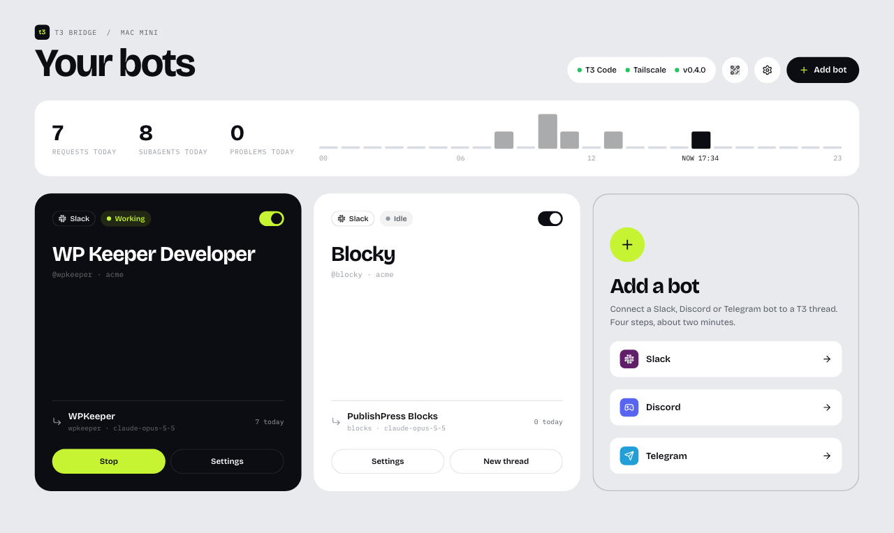

# T3 Bridge

Chat with a T3 Code thread from Slack, Discord or Telegram. Each bot is one Slack app, Discord
bot or Telegram bot talking to one T3 thread. That thread acts as an **orchestrator**: it never
does the work itself, it hands each task to a subagent and reports back. Replies, subagent
progress, approvals, and questions show up in chat; your messages, files, and button clicks go
back to T3.

T3 Bridge runs next to [T3 Code](https://github.com/pingdotgg/t3code) as its own program. It
talks to T3 Code the same way the T3 mobile app does, so updating T3 Code does not touch it. If
T3 Code ever changes its protocol, the bridge shows "Update T3 Bridge" instead of half-working; see
[Keeping up with T3 Code](#keeping-up-with-t3-code).

This is an independent project, not made or supported by T3 Tools.

Requirements: macOS with T3 Code running, Node.js 22.18 or newer, and optionally
[Tailscale](https://tailscale.com) to open the control panel from other devices.

## Install

On the Mac that runs T3 Code (over SSH works too):

```sh
npx t3-bridge install
```

T3 Bridge now runs in the background, starts at login, and pairs with T3 Code by itself. The
command prints the control panel link, `http://<tailscale-ip>:47821/#token=…`. Open it in any
browser on your Tailscale network, your phone included, and bookmark it. Everything else,
adding bots included, happens in that page. The link works like a password.

With T3 Code on more than one Mac, run the same command on each Mac whose threads you want in
chat, and bookmark each link. On a single Mac without Tailscale, open the `127.0.0.1` link.

| Command | |
|---|---|
| `npx t3-bridge` | Run in the terminal instead of in the background |
| `npx t3-bridge install` | Run in the background, starting at login |
| `npx t3-bridge uninstall` | Stop and remove the background service; bots and settings are kept |
| `npx t3-bridge link` | Print the control panel link again |
| `npx t3-bridge status` | Show whether T3 Code and the bots are connected |



The panel opens on your bots: one card per bot with its state (working, idle, waiting for you,
or what's wrong), its thread and today's requests, plus today's totals and requests by hour.
Turn a bot on or off from its card, stop a running request, or start a fresh thread. Open a bot
for its settings: name, thread, who may use it, instructions, and its Slack, Discord or
Telegram tokens.

To update, open **Settings** in the panel and choose **Update**, or run
`npx t3-bridge@latest install`. Settings live in `~/Library/Application Support/T3 Bridge` and
logs in `~/Library/Logs/T3 Bridge.log`.

**Replace link** under **Settings → Open from other devices** issues a new link; every old copy
stops working. The QR code next to it, also behind the QR button on the home page, opens the
panel on your phone.

## Add a Slack bot

In the control panel, choose **Slack** on the **Add a bot** card (or **Add bot → Slack**), and follow the four steps:

1. Name the bot and choose **Create Slack app**. Slack opens with the app filled in; choose
   **Create**, then **Install to Workspace**.
2. Paste the **Bot User OAuth Token** (`xoxb-…`) and an app-level token with the
   `connections:write` scope (`xapp-…`, under **Basic Information → App-Level Tokens**). They
   are checked as you paste.
3. Choose a thread, or create a new orchestrator thread. A new thread is pinned, runs with full
   access, and starts with the orchestrator instructions.
4. Send the bot a direct message in Slack. The first person to do so becomes its owner; add
   others on the bot's page under **Who may use it**.

Message the bot directly, or invite it to a channel with `/invite @bot`. Both go to the same thread. In
a channel, mention the bot (`@bot fix the login page`) or reply under one of its messages; other
channel chatter is ignored.

## Add a Discord bot

In the control panel, choose **Discord** on the **Add a bot** card (or **Add bot → Discord**), and follow the four steps:

1. Name the bot and open the Discord developer portal. Choose **New Application**, then under
   **Bot** choose **Reset Token** and copy the token. Optionally turn on **Message Content
   Intent** there too, so the bot also reads replies that don't mention it.
2. Paste the token. It is checked as you paste; then choose **Add to a server**. Discord only
   lets people message a bot they share a server with.
3. Choose a thread, or create a new orchestrator thread.
4. Send the bot a direct message (its profile → **Message**). The first person to do so becomes
   its owner; add others by Discord user ID on the bot's page under **Who may use it**
   (turn on Developer Mode, then right-click a person → **Copy User ID**).

In a server channel, mention the bot (`@bot fix the login page`) or reply to one of its messages.

## Add a Telegram bot

In the control panel, choose **Telegram** on the **Add a bot** card (or **Add bot → Telegram**), and follow the four steps:

1. Name the bot and open [@BotFather](https://t.me/BotFather). Send `/newbot`, a display name,
   and a username ending in `bot`. BotFather replies with a token like `123456:ABC…`.
2. Paste the token. It is checked as you paste.
3. Choose a thread, or create a new orchestrator thread.
4. Open the bot in Telegram and press **Start**. The first person to do so becomes its owner; add
   others by their numeric Telegram user ID (the bot tells people theirs when it turns them away).

In a group, mention the bot (`@your_bot fix the login page`), reply to one of its messages, or use
`/stop` and `/new`. Forum topics work too: the bot answers in the topic it was asked in.

## Updating an existing bot's Slack app

When a new version needs more Slack permissions, the **Slack app** card on the bot's page says so. It gives
you a new manifest to paste under **App Manifest** on api.slack.com, then asks you to reinstall
the app. The tokens stay the same.

## In Slack

The bot is a Slack AI app. Each request is its own thread in the bot's Messages tab (or under
your mention in a channel): the reply streams in there, along with the request's subagents,
questions, and the summary the orchestrator posts after they finish. Reply in the thread to
continue that request; start a new message for a new one.

- Your message gets 👀 while the agent works, then ✅, ❌, or ⏹, and Slack shows
  "<bot> is working…" in the thread.
- Press Slack's **Stop** button while the agent works, add 🛑 (`:octagonal_sign:`) to any message,
  or send `!stop`, to stop the agent.
- On any message, choose **⋯ → Send to <bot>** to hand it to the agent with a note. The answer
  arrives in your DM with the bot.
- Long reports (over about 4,000 characters) go into a Slack canvas; chat gets the opening and a
  link. Workspaces without canvases get the whole reply in chat.
- Approvals and questions arrive with buttons. You can also answer a question by replying in its
  Slack thread.
- Subagents show as Slack task cards that update while they run. The orchestrator's reply
  summarizes what they found; expand a card to see the start of its raw result.
- Forwarded messages reach the agent with their text, author and link, plus their images and
  files.
- Mention the bot in the replies under any message, such as another app's alert, and the agent
  gets what came before: the message the thread started with and the replies so far, quoted with
  their files. The thread is named after that opening message. In Discord and Telegram the same
  goes for a reply to someone else's message, and a mention in a Discord thread brings what was
  said there since the bot last spoke.
- Images go both ways: pictures you attach in Slack reach the agent, and screenshots or images
  the agent shows (including ones it saved on the Mac) are uploaded to the thread.
- HTML pages the agent renders arrive as an `.html` file.
- Messages typed in T3 itself also show up in Slack, marked _Sent from T3_.
- Every message reaches T3 tagged with its thread, e.g. `[Slack · Riza · thread "Check Pro PRs"]`,
  so a reply like "yes, merge it" arrives with its subject. Slack's thread list uses the same titles.
- When one request starts several subagents, they share one plan card in its thread, including
  subagents the orchestrator starts later for the same request.
- Progress notes the orchestrator writes while a request's subagents are still running edit one
  status message in the thread, so you are notified once, when the work is done. When it has
  nothing to say it replies `NO_REPLY`, which is never posted.
- Send `!new` (or use **New thread** on the bot's card) to start a fresh orchestrator thread with
  the same project, model and instructions when the current one has grown long.

Only allowed people can send work. The bot runs code on your Mac, so keep that list short.

## Project memory

Each bot remembers lasting facts about its project: how to reach a server, where something lives,
decisions, gotchas. Memory belongs to the project, so every thread and subagent on that project
shares it, and bots on other projects never see it. It is the folder Claude Code already keeps
for the project, `~/.claude/projects/<project path>/memory/`, so Claude's own memory and the
bot's are one copy.

- The instructions T3 Bridge sends tell the orchestrator where memory is, to put the facts that
  matter into every subagent brief, and to ask subagents to report new facts. After updating,
  choose **Send the instructions to the thread now** on each bot's page once.
- An agent line starting with `REMEMBER:`, in the orchestrator's reply or a subagent's report,
  is saved to memory. The line is left out of chat, and no note is posted there.
- `!remember <fact>` saves a fact as you said it; `!forget <words>` removes the lines that
  contain those words. Both work in Slack, Discord and Telegram.
- **Project memory** on the bot's page shows the index (`MEMORY.md`) and the files it links.
  Edit or add them there. The agent reads about the first 200 lines of the index, so keep
  details in their own files.

## In Discord and Telegram

Discord and Telegram bots work like a Slack bot without the AI-app layout: replies go straight
into the conversation, the request they answer gets a reaction, and the reply is edited in place
while it is written.

- Your message gets 👀 while the agent works, then ✅, ❌ or ⏹ in Discord, or 👍, 👎 or 🤷 in
  Telegram (which only allows certain reactions). The bot shows "typing…" while it works.
- Send `!stop` (in Telegram also `/stop`), or in Discord react with 🛑, to stop the agent. `!new`
  (`/new`) starts a fresh orchestrator thread.
- Approvals and single-choice questions arrive with buttons. Reply to a question's message to
  answer in your own words, or to answer a question with several parts. Buttons keep working
  after T3 Bridge restarts.
- Long reports (over about 6,000 characters) arrive as a short preview with the whole reply
  attached as a `.md` file. Shorter replies that don't fit one message continue in the next.
- Images, files and forwarded messages reach the agent; Telegram albums arrive as one request.
  Telegram bots can only download files up to 20 MB.
- Images the agent shows are uploaded to the chat, and HTML pages it renders arrive as an
  `.html` file.

## Keeping up with T3 Code

The bridge speaks T3 Code's WebSocket protocol using T3 Code's own contract definitions, copied
into `vendor/t3code` (T3 Code is MIT licensed; `vendor/t3code/SOURCE.md` records the commit).
When T3 Code changes its protocol, refresh them from a T3 Code checkout and rebuild:

```sh
pnpm sync-t3code ~/Code/t3code
pnpm typecheck && pnpm test
```

Then publish a new version (see Develop).

## Develop

```sh
pnpm test        # unit tests
pnpm typecheck
pnpm build       # bundles the CLI (tsdown) and the control panel (vite) into dist/
pnpm start       # builds, then runs in the terminal
node dist/cli.cjs install   # runs this build as the background service
```

To run against an isolated T3 server instead of your own:

```sh
T3_BRIDGE_DATA=/tmp/bridge T3_BRIDGE_PORT=47899 T3_BRIDGE_T3_URL=http://127.0.0.1:4791 \
T3_BRIDGE_PAIR_COMMAND='node apps/server/src/bin.ts auth pairing create --base-dir /tmp/t3' \
node dist/cli.cjs
```

To release, run `npm version patch` (or `minor`) and `git push --follow-tags`. The Release
workflow publishes the new version to npm and creates a GitHub release with notes; installed
copies then offer it under **Updates** in their control panel.

Chat platforms plug in through `ChatAdapter` in `src/engine/core/types.ts`. Slack, Discord
(gateway WebSocket) and Telegram (long polling) are in `src/engine/adapters`; none of them needs
a public URL. Discord and Telegram share the plain-markdown rendering in
`src/engine/core/chatText.ts`.

## License

MIT. The files in `vendor/t3code` are from T3 Code, also MIT; see `vendor/t3code/LICENSE`.
